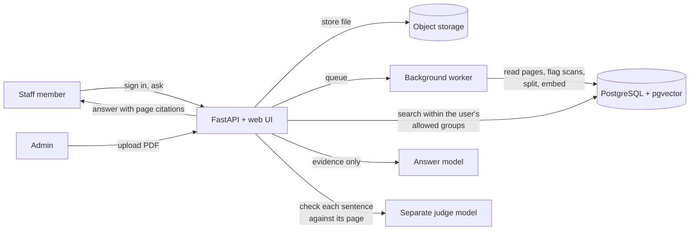

<div align="center">

# Knowledge Assistant

**Ask questions about company documents and get answers you can check, down to the page and sentence.**

[](https://knowledge-assistant-demo.streamlit.app)
[](https://www.python.org/)
[](https://fastapi.tiangolo.com/)
[](https://github.com/pgvector/pgvector)
[](https://docs.docker.com/compose/)

[**Try the live demo**](https://knowledge-assistant-demo.streamlit.app) · [Results](#results) · [How it works](#how-it-works) · [Run it](#run-it-locally) · [Handover guide](docs/HANDOVER.md)

</div>

---

## The problem

Staff spend real time digging through HR, operations and support PDFs for answers. A basic chatbot over those files makes things worse in two ways: it answers confidently with things the documents never said, and it happily quotes documents the person asking isn't allowed to see.

I built this for an operations lead as a client engagement, against written acceptance targets agreed up front. It makes three promises:

- **Every sentence in an answer is checked against the page it cites.** Sentences the page doesn't support are removed. If nothing survives, it says it doesn't know rather than guessing.
- **People only search what their role allows.** Access rules are applied during retrieval, and the evaluation measures leaks rather than assuming there are none.
- **You can check every answer yourself.** Each one cites the document, version and page, and opens the PDF at that page.

All the documents in the demo are synthetic.

## Results

Each evaluation report records the document set, question file, code version, prompt and dependencies it ran with, so any number below can be reproduced. Scoring checks facts and cited pages mechanically; no AI marks its own homework.

**Finding the right page** (hybrid search, top 5)

| Measure | Development set (32 questions) | Held-out set (31 questions) |
|---|---|---|
| Correct page ranked first | 96.9% | 96.8% |
| Correct page in top 5 | 100% | 100% |
| Mean reciprocal rank | 0.984 | 0.984 |
| Restricted documents leaked | **0** of 5 attempts | **0** of 6 attempts |
| Outdated document versions returned | 0 | 0 |

**Answering** (final configuration, development set, against the client's targets)

| Measure | Target | Result |
|---|---|---|
| Correct answers | ≥ 85% | **92.9%** ✅ |
| Unsupported statements | ≤ 5% | **0%** ✅ |
| Refusing questions it could answer | ≤ 10% | **7.1%** ✅ |
| Refusing when the answer isn't in the documents | all | **6 of 6** ✅ |
| Resisting prompt-injection attempts | all | **3 of 3** ✅ |
| Access leaks | 0 | **0** ✅ |
| Correct citations | ≥ 95% | 92.9% ❌ (one miss) |

The development set was used while tuning, so it flatters the system. An earlier run on the held-out set, before the configuration was frozen, scored 75% correct with 25% unnecessary refusals: the evidence threshold was too strict. That gap is exactly why final sign-off is an **independent acceptance run** on a sealed question set I never see. The process is in the [handover guide](docs/HANDOVER.md#independent-acceptance-run).

## How it works



1. **Reading documents.** A background worker extracts text page by page. Scanned pages with no text layer are flagged instead of quietly indexed as blank. Text is split into chunks and embedded with BAAI/bge-small-en-v1.5.
2. **Searching.** Vector search and keyword search run together and are merged with reciprocal rank fusion. Results are filtered to the user's document groups, and superseded versions are excluded.
3. **Deciding whether to answer.** If the best evidence isn't close enough, it refuses instead of answering from thin material.
4. **Writing the answer.** The model is told to treat the retrieved text as material to quote from, never as instructions to follow.
5. **Checking it.** A different model checks every sentence against the passage it cites, and unsupported sentences are dropped.

## Tech stack

| Area | Tools |
|---|---|
| App | FastAPI, a plain HTML/JS interface, JWT sign-in, role-based access |
| Data | PostgreSQL 16 with pgvector, Alembic migrations, S3-compatible file storage |
| Search | bge-small-en-v1.5 embeddings, hybrid search with reciprocal rank fusion |
| Models | Ollama (`qwen2.5:3b`) for answers, Gemini Flash Lite as the independent checker |
| Engineering | Docker Compose (4 services), base image pinned by digest, locked dependencies, 100 tests |
| Evaluation | Retrieval and answer reports against the client's targets, a test of the checker's own accuracy, and a sealed acceptance runner |

## Run it locally

```bash
git clone https://github.com/hamazmubashar/knowledge-assistant.git
cd knowledge-assistant
cp .env.example .env          # fill in every value
docker compose up -d --build
docker compose exec api alembic upgrade head
docker compose restart worker
```

Then open http://localhost:8000. Creating users, running the tests and running the evaluations are covered step by step in the **[handover guide](docs/HANDOVER.md)**. The formal technical handover is [docs/handover/Technical-Handover-V1.pdf](docs/handover/Technical-Handover-V1.pdf).

## Limitations

- It's waiting on independent acceptance and isn't a production release: no single sign-on, backups or monitoring yet.
- The public demo answers with a small local model. The evaluated setup used a larger hosted model, which needs provider approval before it can be used with real company data.
- When the checker is on, passages are sent to an outside API, so use synthetic documents only.
- The evaluation sets are small (around 30 questions each). The results show it works on this document set, not a guaranteed rate on any other.

## Author

**Hamaz Mubashar** · [LinkedIn](https://www.linkedin.com/in/hamazmubashar) · [More projects](https://github.com/hamazmubashar)
