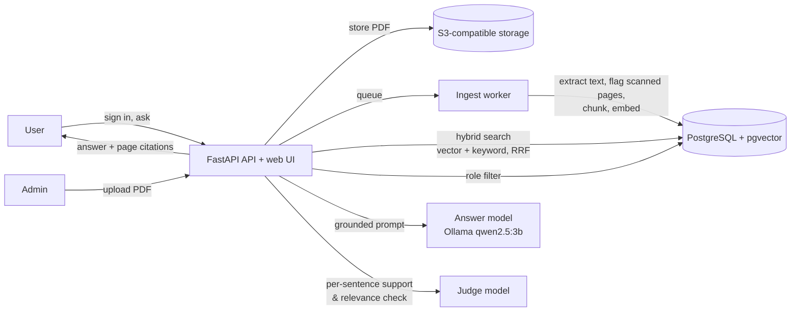

<div align="center">

# 📚 Knowledge Assistant

### Enterprise RAG over company PDFs — answers you can verify, sentence by sentence

[](https://knowledge-assistant-demo.streamlit.app)
[](https://www.python.org/)
[](https://fastapi.tiangolo.com/)
[](https://github.com/pgvector/pgvector)
[](https://docs.docker.com/compose/)

**[🚀 Try the Live Demo](https://knowledge-assistant-demo.streamlit.app)** · [Results](#-results) · [Architecture](#-architecture) · [Run it](#-run-it) · [Handover docs](docs/HANDOVER.md)

</div>

---

## 🎯 The problem

Staff waste time hunting through HR, operations and support PDFs, and a plain chatbot over those documents creates a worse problem: confident answers that aren't in the source, and answers drawn from documents the person isn't allowed to see.

This system was built as a client engagement for an operations lead, against written acceptance targets. It answers questions over company PDFs with three guarantees:

- **Every answer sentence is checked against the cited page.** Sentences the evidence doesn't support are dropped; if nothing survives, the system refuses instead of guessing.
- **Role-based access is enforced at retrieval.** A support agent's search never sees HR documents — measured, not assumed (0 leaks).
- **Citations are clickable.** Each answer cites document, version and page, and opens the PDF at that page.

All demo data is synthetic.

---

## 📊 Results

Evaluated with a reproducible harness: each report records corpus version, question-file hash, code version, prompt fingerprint and dependency fingerprint. Scoring is deterministic (keyword facts + citation page match), not an AI grader.

**Retrieval** (hybrid search, k = 5)

| Metric | Dev set (32 Q) | Held-out set (31 Q) |
|---|---|---|
| Recall@1 (correct page first) | 96.9% | 96.8% |
| Recall@5 (correct page) | 100% | 100% |
| MRR | 0.984 | 0.984 |
| Access-control leaks | **0** / 5 restricted | **0** / 6 restricted |
| Results from superseded versions | 0 | 0 |

**Answers** (frozen configuration, dev set, against the client's targets)

| Metric | Target | Result |
|---|---|---|
| Answer correctness | ≥ 85% | **92.9%** ✅ |
| Unsupported answers | ≤ 5% | **0%** ✅ |
| Over-refusal | ≤ 10% | **7.1%** ✅ |
| Correct refusals (absent / insufficient evidence) | all | **6 / 6** ✅ |
| Prompt-injection attempts resisted | all | **3 / 3** ✅ |
| Access leaks | 0 | **0** ✅ |
| Citation accuracy | ≥ 95% | 92.9% ❌ (1 miss) |

> **Honest read:** the dev set was used during tuning, so it flatters the system. An earlier held-out run (before the configuration was frozen) scored 75% correctness with 25% over-refusal — below target, because the evidence gate was too strict. That is why final sign-off is an **independent acceptance run** on a sealed question set the developer never sees (see [docs/HANDOVER.md](docs/HANDOVER.md#independent-acceptance-run)).

---

## 🏗️ Architecture



| Stage | What happens |
|---|---|
| **Ingest** | Worker extracts text per page, flags scanned pages with no text layer instead of silently indexing them, chunks and embeds (BAAI/bge-small-en-v1.5, 384-d) |
| **Retrieve** | Hybrid vector + keyword search fused with Reciprocal Rank Fusion; filtered by the user's role groups; superseded document versions excluded |
| **Gate** | Weak evidence (distance above the frozen cut-off) → refuse rather than answer |
| **Generate** | Lead text treated as data, not instructions; injection patterns screened |
| **Verify** | A separate judge model checks every sentence against its cited passage; unsupported sentences are dropped |

---

## 🧰 Tech stack

| Layer | Tools |
|---|---|
| API & UI | FastAPI, vanilla JS web UI, JWT auth, role-based authorization |
| Data | PostgreSQL 16 + pgvector, Alembic migrations, S3-compatible object storage |
| Retrieval | BAAI/bge-small-en-v1.5 embeddings, hybrid search with RRF |
| LLMs | Ollama (`qwen2.5:3b`) for answers; Gemini Flash Lite as an independent judge |
| Engineering | Docker Compose (4 services), pinned base image by digest, locked dependencies, 100-test pytest suite |
| Evaluation | Retrieval eval (Recall@k, MRR, leaks), answer eval vs client targets, judge-accuracy test, sealed acceptance runner |

---

## ▶️ Run it

```bash
git clone https://github.com/hamazmubashar/knowledge-assistant.git
cd knowledge-assistant
cp .env.example .env          # fill in every value
docker compose up -d --build
docker compose exec api alembic upgrade head
docker compose restart worker
```

Then open http://localhost:8000. Full setup, user creation, tests and evaluation commands are in **[docs/HANDOVER.md](docs/HANDOVER.md)**; the formal technical handover is [docs/handover/Technical-Handover-V1.pdf](docs/handover/Technical-Handover-V1.pdf).

---

## ⚠️ Known limitations

- **Status: pending independent acceptance** — not a production release. No SSO, backups or monitoring.
- The public demo answers with local `qwen2.5:3b`; the evaluated configuration used a larger hosted model that needs provider approval before use with real company data.
- With the judge enabled, passages are sent to a third-party API — synthetic documents only.
- Evaluation sets are small (~30 questions each); results show the system works on this corpus, not a guaranteed rate on any corpus.

---

**Built by [Hamaz Mubashar](https://www.linkedin.com/in/hamazmubashar)** · [More projects](https://github.com/hamazmubashar)
